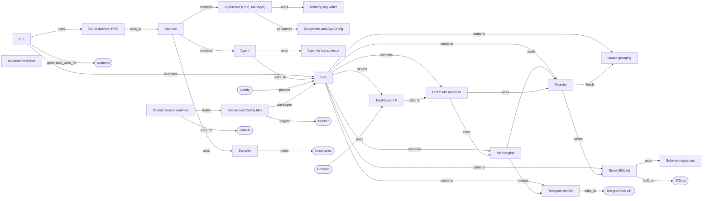
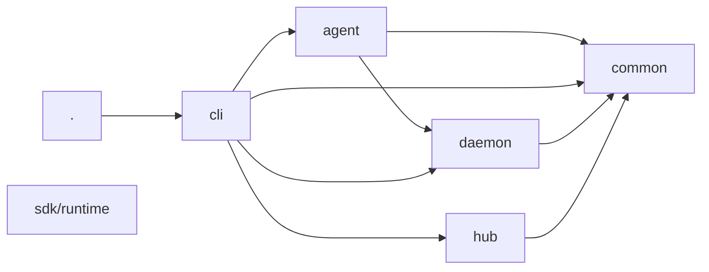
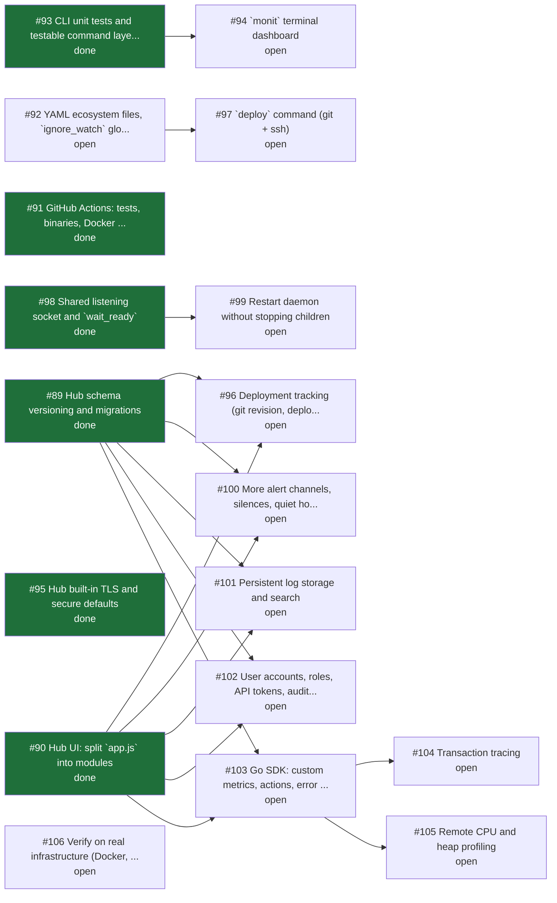

# pm2go graphs

Generated by `go run docs/knowledge-base/graph/gen.go` (do not edit by hand; edit `knowledge-graph.curated.json` for concepts and relations). Machine-readable versions: [`code-graph.json`](code-graph.json) and [`knowledge-graph.json`](knowledge-graph.json).

Use these before reading code: find the component, then open only the files it points to.

- Code graph: 425 nodes, 1120 edges (7 packages, 37 files, 69 types, 295 funcs and methods, 24 HTTP routes).
- Knowledge graph: 117 nodes, 195 edges.

## Architecture (knowledge graph, components and external systems)

## Key flows

- **Start an app**: CLI builds AppConfig (flags or ecosystem) -> RPC start -> Manager.Start creates or updates Procs by name -> Proc.Start spawns the supervise loop.
- **Telemetry**: Monitor samples /proc every 2 s -> Proc caches usage -> Agent builds Snapshot every 2 s -> Hub Registry.OnSnapshot -> SQLite every 10 s -> dashboard charts.
- **Log stream**: Child output -> RotatingFile (file + line hook) -> Agent batch (500 ms) -> Registry ring + issue grouping + live subscribers -> dashboard WebSocket.
- **Alerting**: Engine.Evaluate every 2 s over Registry states -> per rule state machine -> level suppression -> Notifier -> Telegram; history stored in SQLite.
- **Remote command**: Browser POST /api/servers/{name}/command -> Registry.Command -> agent exec -> Manager method -> CommandResult back to the browser.

## Package imports (code graph)

## Issue dependencies and status (knowledge graph)

Arrow means "must land before". Green done, amber in progress or review, default open.

## HTTP routes and handlers (code graph)

| Route | Handler |
|-------|---------|
| `DELETE /api/alerts/rules/{id}` | `deleteRule` (servers/pm2go/hub/api.go:473) |
| `GET /agent/ws` | `agentWS` (servers/pm2go/hub/api.go:109) |
| `GET /api/alerts/active` | (inline) |
| `GET /api/alerts/history` | `history` (servers/pm2go/hub/api.go:485) |
| `GET /api/alerts/rules` | (inline) |
| `GET /api/events` | `events` (servers/pm2go/hub/api.go:379) |
| `GET /api/issues` | `issues` (servers/pm2go/hub/api.go:412) |
| `GET /api/logs/ws` | `logsWS` (servers/pm2go/hub/api.go:331) |
| `GET /api/me` | (inline) |
| `GET /api/servers` | `servers` (servers/pm2go/hub/api.go:184) |
| `GET /api/servers/{name}` | `server` (servers/pm2go/hub/api.go:214) |
| `GET /api/servers/{name}/logs` | `logs` (servers/pm2go/hub/api.go:284) |
| `GET /api/servers/{name}/metrics` | `metrics` (servers/pm2go/hub/api.go:225) |
| `GET /api/settings/info` | `info` (servers/pm2go/hub/api.go:500) |
| `GET /api/settings/telegram` | `getTelegram` (servers/pm2go/hub/api.go:510) |
| `GET /healthz` | (inline) |
| `POST /api/alerts/rules` | `addRule` (servers/pm2go/hub/api.go:443) |
| `POST /api/issues/status` | `issueStatus` (servers/pm2go/hub/api.go:416) |
| `POST /api/login` | `login` (servers/pm2go/hub/api.go:92) |
| `POST /api/logout` | (inline) |
| `POST /api/servers/{name}/command` | `command` (servers/pm2go/hub/api.go:298) |
| `POST /api/settings/telegram/test` | `testTelegram` (servers/pm2go/hub/api.go:530) |
| `PUT /api/alerts/rules/{id}` | `updateRule` (servers/pm2go/hub/api.go:456) |
| `PUT /api/settings/telegram` | `putTelegram` (servers/pm2go/hub/api.go:518) |

## Packages

| Package | Files | Types | Funcs | Summary |
|---------|-------|-------|-------|---------|
| `.` | 1 | 0 | 1 | pm2go is an internal process manager modelled on PM2. |
| `agent` | 1 | 1 | 12 | Package agent connects the daemon to a hub: it streams snapshots, events and log lines out, and runs commands the hub sends back. |
| `cli` | 5 | 3 | 34 |  |
| `common` | 5 | 17 | 24 |  |
| `daemon` | 11 | 16 | 89 |  |
| `hub` | 11 | 29 | 125 | Package hub is the web dashboard server: it accepts agent connections, stores metrics and events, evaluates alert rules and notifies Telegram. |
| `sdk/runtime` | 3 | 0 | 6 | Package runtime lets an application started by pm2go use the shared listening socket and the readiness protocol. |

## How agents should use this

1. Read this file, then open the **component** in knowledge-graph.json: its "code" refs name the packages, types and files to read, and "docs" names the document that explains the behaviour.
2. To find who calls a function: in code-graph.json look for edges with kind "calls" and "to" equal to its id. Edges with "approx": true were matched by a unique method name only; verify them.
3. To find what an issue touches: knowledge-graph.json edges "changes" from issue:N, plus the issue's own file under docs/knowledge-base/pm2go-work/.
4. Node ids: pkg:<dir>, file:<path>, type:<dir>.<Name>, func:<dir>.<Name>, method:<dir>.<Type>.<Name>, route:<METHOD /path>.
5. After changing structure (new package, type, route, issue, component): rerun the generator and commit the three generated files.

### Query recipes (jq)

~~~bash
# all callers of a function
jq -r '.edges[] | select(.kind=="calls" and .to=="method:daemon.Manager.Reload") | .from' docs/knowledge-base/graph/code-graph.json
# everything an issue changes
jq -r '.edges[] | select(.from=="issue:103" and .kind=="changes") | .to' docs/knowledge-base/graph/knowledge-graph.json
# open issues that depend on nothing open
jq -r '.nodes[] | select(.kind=="issue" and .status=="open") | .id' docs/knowledge-base/graph/knowledge-graph.json
~~~
